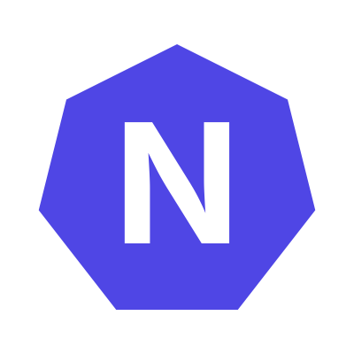

<p align="center"></p>

# Nitrozen MCP Server

Official remote [Model Context Protocol](https://modelcontextprotocol.io) server for [Nitrozen.io](https://nitrozen.io), the hosted changelog platform. Let your AI assistant create projects, write and publish changelog entries, and read your public changelog.

- **Endpoint:** `https://mcp.nitrozen.io/mcp` (Streamable HTTP, hosted on Cloudflare Workers)
- **Docs:** https://nitrozen.io/docs/mcp

Nothing to install: it is a hosted server. This repository holds the Worker source.

## Tools

| Tool | Description |
|------|-------------|
| `get_user` | Get authenticated user profile and plan |
| `get_usage` | Get usage statistics and plan limits |
| `list_projects` | List all changelog projects (each includes `public_url`) |
| `create_project` | Create a new project |
| `get_project` | Get a project by ID, including its `public_url` |
| `update_project` | Update project name/description |
| `delete_project` | Delete a project |
| `list_entries` | List entries for a project (paginated) |
| `create_entry` | Create a changelog entry |
| `get_entry` | Get an entry by ID |
| `update_entry` | Update an entry |
| `delete_entry` | Delete an entry |
| `list_tokens` | List API tokens |
| `create_token` | Create a new API token |
| `revoke_token` | Revoke an API token |
| `get_public_entries` | List published entries by project slug (no auth) |

## Authentication

- **Claude.ai** uses OAuth 2.0: add the server URL and authorize in the browser. No token needed.
- **All other clients** send an API token in a header: `Authorization: Bearer <your-api-token>`. Create a token on the [API Tokens](https://app.nitrozen.io/api-tokens) page (choose the `read` scope for read-only access).

Requests without a valid token get `401` with a `WWW-Authenticate` header pointing to `https://mcp.nitrozen.io/.well-known/oauth-protected-resource`.

## Connect your client

### Claude.ai
Settings → Connectors (Integrations) → Add custom connector → `https://mcp.nitrozen.io/mcp`, then sign in to Nitrozen and approve.

### Claude Code
```bash
claude mcp add --transport http nitrozen https://mcp.nitrozen.io/mcp \
  --header "Authorization: Bearer <your-api-token>"
```

### Cursor (`~/.cursor/mcp.json`) / Windsurf / other JSON configs
```json
{
  "mcpServers": {
    "nitrozen": {
      "url": "https://mcp.nitrozen.io/mcp",
      "headers": { "Authorization": "Bearer <your-api-token>" }
    }
  }
}
```

### Cline (`cline_mcp_settings.json`)
```json
{
  "mcpServers": {
    "nitrozen": {
      "type": "streamableHttp",
      "url": "https://mcp.nitrozen.io/mcp",
      "headers": { "Authorization": "Bearer <your-api-token>" },
      "disabled": false
    }
  }
}
```

### VS Code (`.vscode/mcp.json`)
```json
{
  "servers": {
    "nitrozen": {
      "type": "http",
      "url": "https://mcp.nitrozen.io/mcp",
      "headers": { "Authorization": "Bearer <your-api-token>" }
    }
  }
}
```

### Docker (stdio bridge)
For stdio-only clients, the included `Dockerfile` bridges to the hosted server with `mcp-remote`:
```bash
docker build -t nitrozen-mcp .
docker run -i --rm -e NITROZEN_API_TOKEN=<your-api-token> nitrozen-mcp
```

## Development

```bash
npm install
npm run dev      # local Worker
npm run deploy   # deploy to Cloudflare
```

## License

See [LICENSE](LICENSE).
